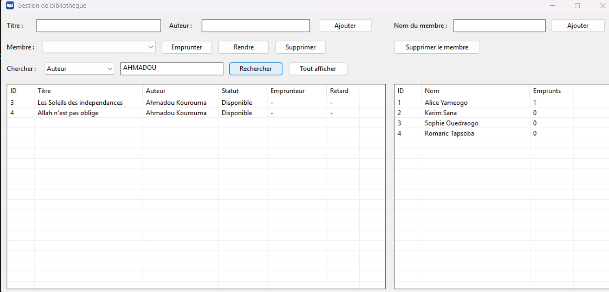
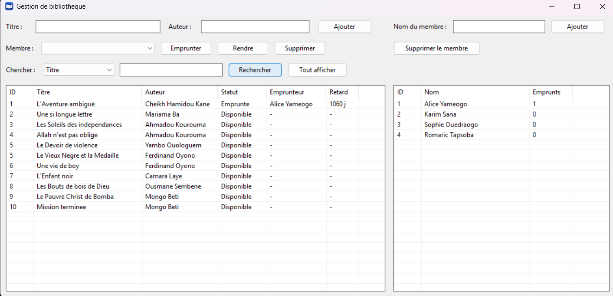

# Gestion de bibliothèque en C

Application de gestion de bibliothèque pour **Windows**, écrite en **langage C** : livres, membres, emprunts, détection des retards, avec une interface graphique native (API Win32) et une version console.



## Fonctionnalités

- **Livres** : ajout, suppression, recherche (titre, auteur, disponibles, empruntés, en retard), tri en cliquant sur les en-têtes de colonnes
- **Membres** : ajout, suppression, nombre d'emprunts en cours
- **Emprunts** : emprunter et rendre, limite de 3 livres par membre, durée de 14 jours, colonne « Retard » (nombre de jours de retard)
- **Sauvegarde automatique** dans des fichiers texte (`livres.txt` et `membres.txt`)
- **Deux interfaces** : une fenêtre Windows et un menu en console, qui partagent le même code



## Essayer le programme

Télécharge `Bibliotheque.exe` dans l'onglet **Releases** de ce dépôt, mets-le dans un dossier où tu peux écrire (Bureau, Documents...) et lance-le.

> Windows peut afficher « Windows a protégé votre ordinateur », car le programme n'est pas signé : clique sur **Informations complémentaires**, puis **Exécuter quand même**.

## Compiler le projet

Prérequis : Code::Blocks avec le compilateur MinGW (GCC).

1. Garde les dossiers `bibilio2` et `test_project` côte à côte.
2. Ouvre le fichier `.cbp` de `test_project` (interface graphique) ou de `bibilio2` (console).
3. Pour la version graphique, vérifie dans les options du projet :
   - Type : **GUI application**
   - Bibliothèques à lier : `comctl32`, `gdi32`
   - Dossiers de recherche du compilateur : ajoute le dossier `bibilio2` (les modules y sont partagés)
   - Pour la version finale (Release) : ajoute `-s -static` aux options de l'éditeur de liens
4. **Build > Rebuild**.

## Structure du projet

| Fichier | Rôle |
|---|---|
| `bibilio2/bibliotheque.c/.h` | Logique des livres, emprunts, retards, recherche, tri |
| `bibilio2/membre.c/.h` | Logique des membres |
| `bibilio2/utils.c/.h` | Lecture au clavier et fonctions utilitaires |
| `bibilio2/main.c` | Menu console |
| `test_project/main.c` | Interface graphique Win32 |
| `test_project/resources.rc`, `app.manifest`, `icone.ico` | Icône et aspect moderne des contrôles |

La logique est séparée de l'affichage : les fonctions renvoient un code de résultat (`Resultat`) et ne lisent ni n'affichent rien, ce qui permet de les réutiliser dans la console et dans la fenêtre.

## Format des données

```
membres.txt : id;nom
livres.txt  : id;titre;auteur;disponible;idMembre;dateEmprunt
```

Le caractère `;` est interdit dans les titres, auteurs et noms.

## Limites connues

- Interface graphique pour Windows uniquement
- Données stockées dans des fichiers texte (pas de base de données)
- Nombre de membres limité à 50

## Pistes d'amélioration

Export CSV, historique des emprunts, modification d'un livre, sauvegarde automatique des données.

## À propos

Projet d'apprentissage du langage C, réalisé étape par étape avec l'aide d'une IA pour les explications et la relecture du code.

## Licence

MIT, voir le fichier `LICENSE`.
